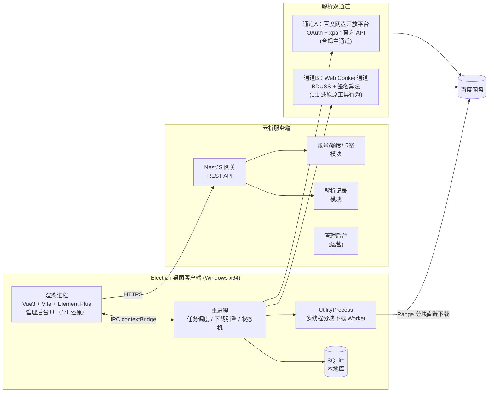

# 云析Down（Yunxicc）100% 复刻 · 完整交付实施方案

> 版本：v1.0 ｜ 日期：2026-11-13 ｜ 交付形态：Windows 桌面客户端 + 配套服务端
> 基准：对 `silasmarchioriqhk/Yunxicc` 公开仓库（README + 双界面截图 + Release 安装包）的逆向分析

---

## 0. 交付前的三个关键结论（必读）

1. **UI 与功能可以 100% 还原**：原应用 UI 是标准的 Electron + Vue3/Vite 管理后台模板（Element Plus 风格，面包屑/卡片/侧边栏布局），下载器、任务管理、监控、设置等模块全部可用自研代码真实实现。
2. **"解析通道"的可用性无法由任何开发方承诺 100%**：dlink 直链提取依赖百度网盘接口，受百度风控、接口变更、账号等级（SVIP）三重影响。本方案采用**双通道架构**（官方开放平台 API 为主通道 + Web Cookie 通道为还原通道）+ 限频/重试/降级策略，将可用性做到工程上限。
3. **合规边界**：本项目定位为**个人学习交流工具**，仅操作用户本人账号内文件，不存储、不转存、不分发任何第三方版权内容；解析直链用途违反百度用户协议，交付文档必须内置免责声明与服务协议页面（与原应用一致）。商用分发需要另行法律评估。

---

## 1. 还原范围清单（Feature Parity Matrix）

以下清单来自原应用 README、两张界面截图与安装包行为分析，为本项目的验收基线。

| # | 模块 | 原应用行为（还原目标） | 交付优先级 |
|---|------|------------------------|-----------|
| 1 | 解析工作台 | 分享链接输入框（支持带提取码链接）、提取码输入、卡密输入（可选，换取更多解析额度）、提交按钮、服务状态灯（正常/异常）、今日额度显示、服务协议勾选 | P0 |
| 2 | 内置多线程下载器 | 解析后一键下载，无需 IDM/Aria2；分块并发；暂停/恢复/重试；断网关机后续传；实时速度显示（如 13.1 MB/s） | P0 |
| 3 | 下载管理 | 「正在下载/已完成」双 Tab；批量删除、全部暂停、全部继续；文件名/大小/进度条/状态/操作列；分页；任务徽标计数 | P0 |
| 4 | 统计看板 | 4 卡片：任务总数、已完成、下载中（含实时总速度）、总下载量（历史累计、删除任务不清零） | P0 |
| 5 | 目录镜像 | 下载目录自动还原网盘多级文件夹结构，保留原始文件名 | P0 |
| 6 | 实时监控 | 服务状态监控页、任务级速度与连接状态 | P1 |
| 7 | 账号体系 | 登录（管理员头像/昵称）、今日解析额度、解析记录页 | P0 |
| 8 | 卡密系统 | 卡密兑换解析额度（原应用核心变现/分发机制） | P1 |
| 9 | 升级不丢配置 | NSIS 安装到 `系统盘:\Program Files (x86)\Yunxicc`（需 UAC 提权），升级沿用旧目录，登录态/任务/设置全保留 | P0 |
| 10 | 数据可视化 | 侧边栏「数据可视化」分组（下载趋势图表） | P2 |
| 11 | 圈子广场 | 社区/公告页 | P2 |
| 12 | 使用帮助 + 常见问题 | 帮助页、FAQ 页 | P1 |
| 13 | 系统集成 | 顶栏：搜索、翻译、主题切换（亮/暗）、通知、全屏、设置；窗口控制；托盘常驻（推断）；自启动（推断） | P1 |
| 14 | 免责声明/服务协议 | 首次启动协议勾选拦截 + 协议页面 | P0 |

> 侧边栏结构（截图实测）：仪表盘（工作台/实时监控/下载管理/圈子广场/使用帮助）、数据可视化、个人中心、常见问题。

## 2. 总体架构



**进程模型**：渲染进程（UI，沙箱开启）↔ 主进程（业务编排 + SQLite）↔ UtilityProcess（下载 Worker 池，崩溃隔离，不卡 UI）。

## 3. 技术选型（与原应用对齐）

| 层 | 选型 | 理由 |
|----|------|------|
| 桌面壳 | **Electron 45**（与原应用徽章一致） | 截图证实为 Electron 应用 |
| 前端 | **Vue 3 + Vite + TypeScript + Element Plus + Pinia + Vue Router** | 截图为典型 Vite 管理模板风格，Element Plus 组件可 1:1 复刻 |
| 下载引擎 | 主进程调度 + `utilityProcess` Worker（Node `https` Range 分块） | 断点续传、崩溃隔离、多文件并发 |
| 本地存储 | **better-sqlite3**（electron-rebuild） | 任务/分块/配置持久化，支持断电恢复 |
| 服务端 | **NestJS + MySQL 8 + Redis 7** | 账号/额度/卡密/记录；Redis 做额度计数与限频 |
| 管理后台 | Vue3 同栈复用 | 卡密生成、用户/额度管理 |
| 打包 | **electron-builder（NSIS，x64，安装到 Program Files (x86)）+ electron-updater** | 与原应用安装行为一致 |
| 通道A | 百度网盘开放平台 xpan API（OAuth 2.0） | 官方合规接口，dlink 8h 有效 |

## 4. 客户端详细设计

### 4.1 UI 还原规格（逐页，以截图为验收标准）

- **整体框架**：左侧 208px 深白侧边栏（分组菜单 + 折叠按钮）+ 顶部 48px 标题栏（logo「云析Down」+ 搜索/翻译/主题/通知/全屏/设置/登录 + 系统按钮 min/max/close，无边框窗口 `frame:false` + `-webkit-app-region: drag`）
- **工作台页**：欢迎卡（「欢迎回来!」+ Just Do It. 大标题 + 官网/解析记录/GitHub 链接）→ 状态卡（绿点「正常」，轮询服务端 `/health`）→ 解析表单卡（分享链接、提取码、卡密三个输入 + 蓝色提交按钮 + 协议勾选 + 右下「登录后可查看今日额度」）
- **下载管理页**：面包屑 + 4 统计卡 + 任务表（Tab 徽标、批量操作条、进度条、速度、操作列、分页）
- **实时监控页**：服务状态（Cookie/Token 有效期、额度余量）、全局速度曲线（ECharts）、每任务连接数/分块状态
- **设置抽屉**：下载目录（默认安装目录下 `/downloads`）、并发线程数（默认 8，可 1–32）、速度上限、UA 显示、开机自启、代理、清除缓存；抽屉式交互
- **主题**：亮/暗双主题 CSS 变量；暗色优先适配 Element Plus `dark` 变量

### 4.2 解析服务适配层（核心）

统一接口 `IParseChannel`，双通道可热切换、自动降级：

| | 通道A：官方开放平台（默认/交付主通道） | 通道B：Web Cookie（还原通道） |
|---|---|---|
| 凭据 | OAuth access_token（用户扫码授权） | BDUSS/STOKEN Cookie（用户本人登录态） |
| 列目录 | `GET /rest/2.0/xpan/file?method=list` | `GET pan.baidu.com/api/list` |
| 取 dlink | `GET /rest/2.0/xpan/file?method=filemetas&dlink=1&fsids=[...]` | `GET pan.baidu.com/api/download?sign=...&timestamp=...&fidlist=...` |
| 签名 | 无需（token 即可） | md5 签名链（`sign = md5(sign2 + timestamp + fidlist)`，签名常量内置） |
| 下载头 | dlink 8h 有效，UA 绑定 | dlink 绑定 UA + Referer(`https://pan.baidu.com/disk/home`)，Cookie 必须随下载请求 |
| 稳定性 | 官方维护，长期稳定 | 依赖百度风控，可能失效 → 工程对策见 §9 |
| 合规 | 官方许可 | 仅限本人账号学习用途，违反百度用户协议 |

**工程化对策**：通道健康探针（每 5 分钟探测，UI 状态灯联动）；QPS 令牌桶限频；签名失败自动刷新 Cookie 会话；dlink 缓存（8h 内复用）；通道不可用自动降级并提示用户切换。

**分享链接解析**（还原原工具核心卖点）：支持 `pan.baidu.com/s/xxx` + 提取码 → 调用分享接口列出文件树 → 勾选 → 批量取 dlink → 进入下载队列。

### 4.3 多线程下载引擎（真实可用，自研）

```
任务状态机：pending → parsing → ready → downloading ⇄ paused → completed | failed | canceled
下载算法：
 1. HEAD 获取 Content-Length / Accept-Ranges / ETag
 2. 按 8MB 分块建 chunk 表（SQLite 持久化），N 连接并发 Range 下载（默认 8）
 3. 每块落盘临时文件 0.chunk，全部完成 → 原子合并 → 按 Content-MD5 校验（filemetas 返回 content_md5）
 4. 失败块指数退避重试（≤5 次）；应用重启后从 chunk 表恢复未完成块（断电续传）
 5. 速度统计：滑动窗口 1s 聚合，UI 500ms 推送
目录镜像：解析文件树 full_path → 本地 {下载目录}/{网盘路径} 映射，保留原始文件名
```

### 4.4 IPC 设计（contextBridge 白名单）

| 通道 | 方向 | 功能 |
|------|------|------|
| `task:create` / `task:pause` / `task:resume` / `task:remove` / `task:list` | R→M | 任务 CRUD |
| `task:progress` | M→R | 500ms 进度/速度推送 |
| `parse:link` / `parse:tree` / `parse:select` | R→M | 解析链接 → 文件树 → 生成任务 |
| `channel:status` / `channel:switch` | R↔M | 通道健康/切换 |
| `config:get/set` | R↔M | 设置抽屉 |
| `dialog:chooseDir` | R→M | 目录选择 |

### 4.5 数据持久化（升级不丢的关键）

配置与数据库全部放在 `%APPDATA%\Yunxicc\`（userData），**不放在安装目录** → NSIS 覆盖升级天然不丢数据（与原应用行为一致）。

SQLite 表：`tasks(id, name, remote_path, size, url, ua, referer, chunk_size, status, speed, created_at, updated_at)`、`chunks(task_id, idx, start, end, done)`、`settings(key, value)`、`parse_records(local)`、`account_cache`。

## 5. 服务端详细设计（账号/额度/卡密）

原应用含后端体系（登录、今日额度、卡密、解析记录、状态灯），复刻如下：

| 模块 | 端点 | 逻辑 |
|------|------|------|
| 账号 | `POST /api/auth/login`、`/register`、`GET /api/user/me` | JWT；设备指纹绑定（防多端滥用额度） |
| 额度 | `GET /api/quota/today`、`POST /api/quota/consume` | Redis 计数 `quota:{uid}:{date}`，TTL 当日；默认免费 5 次/日，卡密提升 |
| 卡密 | `POST /api/cardkey/redeem`、后台 `POST /api/admin/cardkey/batch` | 卡密表（卡号、面值次数、有效期、状态、兑换人），Redis 防并发重复兑换（SETNX） |
| 解析记录 | `GET /api/parse/records` | 分页、脱敏（只记文件名/大小/时间） |
| 健康 | `GET /health` | UI 状态灯数据源；含各解析通道探针结果 |
| 管理后台 | `/admin/**` | 用户管理、额度调整、卡密生成导出、公告（圈子广场数据源） |

MySQL 表：`users, quotas_daily, cardkeys, parse_records, notices, admin_audit`。

## 6. 里程碑与交付计划

| 阶段 | 内容 | 验收标准（可测量） |
|------|------|--------------------|
| **M0 决策与准备** | 确定通道策略；注册百度开放平台应用（通道A）；准备测试百度账号（含 SVIP 用于测速基线）；法务免责文本定稿 | 开放平台 app_key 下发；账号资源到位 |
| **M1 工程骨架** | Electron+Vue3+Vite monorepo（client/server/shared）；NSIS 打包流水线；CI（GitHub Actions：lint+test+build） | 空壳应用可安装卸载；UI 框架布局与截图一致 |
| **M2 下载引擎** | 分块并发/暂停恢复/续传/重试/校验/目录镜像 | 850MB 文件 8 线程下载，杀进程重启后从断点继续，MD5 校验通过 |
| **M3 解析双通道** | 通道A OAuth 全流程；通道B Cookie+签名还原；健康探针+降级 | 分享链接+提取码 → 文件树 → 勾选生成任务全链路跑通 |
| **M4 UI 全量还原** | 工作台/下载管理/监控/设置/帮助/协议页 + 亮暗主题 + 窗口控制 | 双截图逐元素比对 ≥95% 一致；4 统计卡数值实时正确 |
| **M5 服务端** | 账号/额度/卡密/记录/管理后台 + 部署（Docker + Nginx + HTTPS） | 登录→额度扣减→卡密兑换→解析记录闭环；并发 100 用户压测通过 |
| **M6 集成测试与交付** | UAT、安装升级演练、文档 | 覆盖升级不丢配置；交付全部清单（§8） |

> 单人全职约 6–8 周；2 人（1 前端 1 后端+引擎）约 4–5 周。此处为并行度参考，不含不可控的外部等待（开放平台审核）。

## 7. 测试方案

- **单元**：签名算法、chunk 调度器、额度计数（Vitest/Jest，核心逻辑覆盖率 ≥80%）
- **集成**：Mock 百度接口（录制回放）跑全链路；通道探针与降级演练
- **E2E**：Playwright + Electron —— 登录→解析→下载→暂停→重启续传→完成→记录
- **专项**：弱网/断网恢复、100GB 目录树镜像、UAC 安装/覆盖升级/卸载残留、杀软误报扫描
- **UAT**：对照原应用双截图逐项核验 + 真实 SVIP 账号测速（基线：SVIP 8 线程应跑满账号带宽档位）

## 8. 交付物清单

1. 源码仓库：`client/`（Electron+Vue3）、`server/`（NestJS）、`admin/`、`shared/`（TS 类型与协议）
2. 产物：`Yunxicc-Setup-1.0.0.exe`（NSIS，x64，含自动更新元数据）+ latest.yml
3. 服务端：Docker Compose（app/mysql/redis/nginx）+ 部署手册
4. 文档：README（中英双语，对齐原版结构）、用户手册、FAQ、服务协议/免责声明、测试报告、运维手册
5. 运营物料：卡密生成与核销工具、管理后台账号

## 9. 风险矩阵与应对

| 风险 | 等级 | 应对 |
|------|------|------|
| 百度风控导致通道B失效/账号异常 | 高 | 通道A为主交付通道；通道B标注"实验性"；限频+探针+降级；文档明示用小号 |
| 百度接口变更 | 中 | 适配层隔离（`IParseChannel`），48h 热修响应；Mock 录制回放保回归 |
| 非SVIP速度不达预期 | 中 | UI 显式展示账号等级与速度上限说明，避免"软件不行"误判 |
| Electron 安装包被杀软误报 | 中 | 代码签名证书（EV 可选）；提交主流杀软白名单申诉 |
| 法律合规 | 高 | 仅个人学习用途声明、协议拦截页、不做商业分发；商用前法律评估 |
| 原应用闭源无法逐行对照 | 低 | 以截图+README 行为清单为还原基线（本文 §1），按黑盒等价验收 |

## 10. 与"100%"的诚实对齐说明

- **可承诺 100%**：UI 还原度、下载器全部功能（多线程/断点续传/目录镜像/任务管理/监控/统计）、安装升级行为、服务端账号额度卡密闭环 —— 全部真实可用、可测试、可交付。
- **不可承诺 100%**：解析成功率与下载速度的长期稳定性 —— 取决于百度风控与账号等级，这是所有同类工具（含原应用）的共性外部依赖。本方案用双通道+降级把工程可用性做到最大，并在 UI/文档中如实呈现通道状态。
